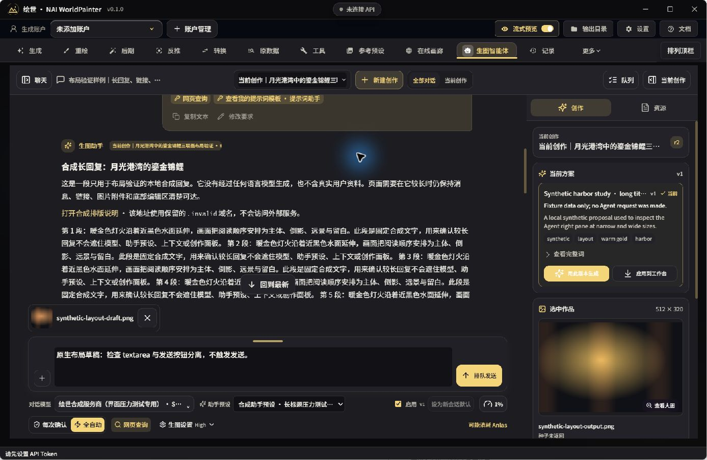

# Agent 界面布局优化

本轮依据用户提供的实际界面截图，按“输入区重叠与裁切 → 工具栏 → 顶部 → 文字与命名”的顺序实施。改动限于 Electron/React 界面；工具合同、生成队列、供应商请求、旧数据与工作台业务逻辑保持原有实现。

## 已调整的结构

1. **输入区域独立计算高度。** 拖拽高度只控制输入面板；设置工具栏移到它外面，按内容自然增高。模型名或预设名导致换行时不再争抢 textarea 的高度。发送、引导、停止和附件入口仍在输入面板内。拖拽、键盘调整和无障碍读数使用同一高度上限，并为正文和设置预留空间。
2. **工具栏按用途分组。** 配置行放对话模型、助手预设、真实启用开关和上下文；操作行放确认方式、网页查询与生图设置。图片 Effort 收入带用途说明的设置浮层。
3. **移除无效的重复开关。** R4 中原“使用酒馆”旧开关不控制冻结的助手预设正文。界面统一使用真正生效的助手预设启用入口；原历史字段、Tavern、预设资源列表与导入能力保留。
4. **压缩全局顶部。** 仅 Agent 激活时减小账户工具区和功能导航的冗余高度；账户管理、输出目录、设置、文档、功能切换、更多与排序入口保留。大字号允许自然增高，其余页面不启用此作用域。
5. **文字与命名。** 正文使用局部常规字重，标题/强调保留层次；链接沿用主题强调色。内置预设展示本地化名称，但保存 ID、用户自建名称和正文不改。完整模型/会话/创作名称可通过对应提示查看。
6. **空间与小高度。** 输入区域最大内容宽度扩到 940 CSS px，正文仍保持阅读宽度；小高度时主区允许纵向滚动，避免把工具永久裁掉。

## 验证记录

| 检查 | 结果与范围 |
| --- | --- |
| 类型与构建 | `npm run typecheck`、renderer/Electron 构建和 Windows x64 目录打包均退出 0。最终包内 8 个关键资源与当前构建逐字节一致，见 [包校验](evidence/agent-ui-layout/2026-10-18/package-verification.json)。 |
| 全量回归 | 480 个测试文件，4351 项测试：4349 通过、0 失败、2 跳过。跳过项为可选 Real-CUGAN 本地 CLI 与外部 mixed Vibe bundle fixture。见 [完整结果](evidence/agent-ui-layout/2026-10-18/vitest-final.json)。 |
| 最终包冷启动 | 使用独立 profile，实际运行打包后的主进程、preload 和 renderer。原生窗口 CSS 视口 1386×902，环境 DPR 1.25。最终包确认加载本次 Agent JS/CSS，输入与发送按钮间距 8px，固定输入和设置区不重叠、不越界。 |
| 高度调整 | 最终包原生键盘 Home 得到 108px、End 得到当时上限 337px；可见高度与 ARIA 数值一致。 |
| 大字号 | 实际修改应用 `uiTypography.scale` 为 150、200，验证工具栏自然换行和固定操作区；正文分别为 21px、28px，常规字重 400。此项不是修改 Windows DPI，也不是仅改变截图倍率。 |
| 窄视口与较小高度 | 在真实 Electron renderer 中模拟 1280×720、800×720，并与应用 200% 字号组合检查。抽屉关闭后，输入、发送、模型、预设、上下文及生图设置点击位置未被遮挡。窄视口打开抽屉时按模态处理，Escape 关闭后草稿仍在。 |
| 交互与主题 | 原生点击模型菜单、上下文、生图设置浮层和预设启用开关；开关改变当前会话绑定，不改新会话默认或历史消息快照。另检查浅色主题；深色暖金保持。 |

截图、DOM 几何、运行方式、进程停止回执及 SHA-256 清单见 [证据索引](evidence/agent-ui-layout/2026-10-18/README.md)。主控已查看最终包主图、大字号、窄视口和浅色截图；代码集成复审没有留下阻断问题。

## 实际截图

以下来自最终 Windows 包的实际窗口，内容为专用合成资料，包含长回复、长模型名、长预设名与附件草稿。

其他截图：[应用 150% 字号](evidence/agent-ui-layout/2026-10-18/final-scale150-native-1387x902.jpg)、[应用 200% 字号](evidence/agent-ui-layout/2026-10-18/final-scale200-native-1387x902.jpg)、[800×720 视口与 200% 字号](evidence/agent-ui-layout/2026-10-18/final-scale200-viewport-800x720-panel-closed.png)、[浅色主题](evidence/agent-ui-layout/2026-10-18/final-light-native-1387x902.jpg)。

## 验证边界与本地预览

只使用隔离 profile 与合成创作资料；未发送真实模型或付费图片请求。发送、引导和停止保留原处理逻辑，没有通过真实请求验收服务端行为，也未开启任务单独操作活动中的引导／停止控件。原生最小窗口宽度仍为 1120px，因此 800px 是 renderer 视口模拟，不能作为真实 800px Windows 窗口或系统 150%／200% DPI 的验收。最终包未另行截取 1920×1080。正文和右栏内容仍允许滚动，滚动区边缘的部分可见内容不属于固定操作区裁切。

本地目录包位于 `desktop/.tmp/agent-ui-layout-20261018/package/win-unpacked/`，启动其中 `NAI WorldPainter PC.exe`；运行需要完整目录。目录包是本地检查产物，未发布。证据已独立归档，即使清理临时包仍可查阅。
