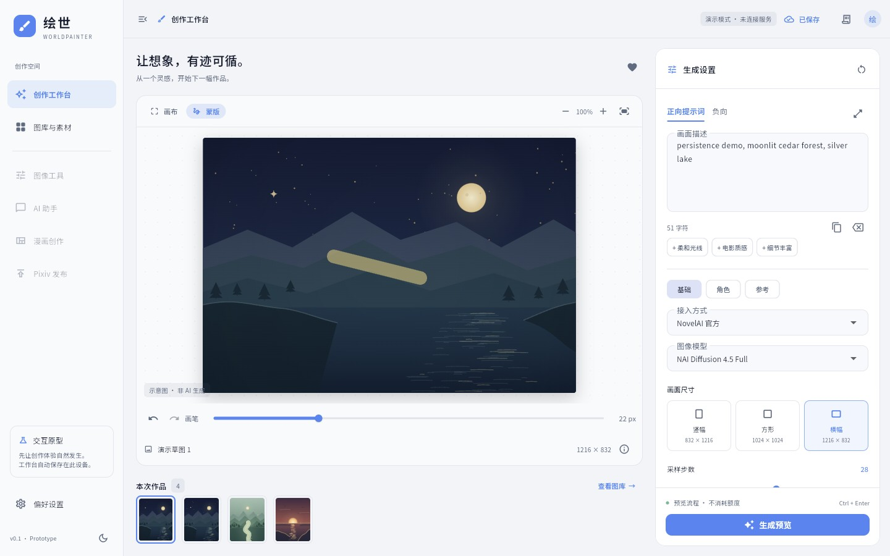

# 工作区持久化与 Windows 存储验证

日期：2026-10-11。阶段：M1 的持久化增量；不代表全部 Windows 能力或手机端功能移植完成。

## 本轮实现

- 打开工作台前从 SQLite 恢复草稿和图库；首次运行建立原型 schema 1。过新、损坏或无法打开的数据库显示错误，不自动清空或回退成“已保存”的内存模式。
- 正负提示词、模型、接入方式、尺寸、步数、CFG、Seed、图库记录顺序、选中项、收藏、主题、减少动画、角色/位置及逐图蒙版/撤销状态自动保存。重开不会再把草稿覆盖为第一张示意图的参数。
- 保存队列合并连续编辑，事务成功之后才显示“已保存”；错误保留当前内存内容，可手动重试。revision CAS 拒绝陈旧窗口覆盖其他窗口提交的版本。当前尚无多窗口自动合并/冲突恢复向导，正常使用应保持一个编辑窗口。
- Windows 的 `WM_CLOSE` 请求先交给 Dart，取消未完成的模拟生成、冻结后续编辑并等待保存；成功后才关闭窗口，失败则保留窗口。强制结束进程、断电与系统关机并不走此确认流程，不能承诺保留尚未提交的输入。
- Windows 采用 `sqflite_common_ffi 2.4.3` / `sqlite3 3.7.0` 后台 isolate；Web 预览用 `sqflite_common_ffi_web 1.2.0` SharedWorker + IndexedDB，数据相互独立。依赖版本、许可与资源哈希见 [第三方记录](THIRD_PARTY.md)。

## 数据位置

开发版经 `scripts/build-windows.ps1` 构建后默认使用本仓库 `data/desktop/workspace.sqlite`，通过 UTF-8 Base64 编译参数传递中文路径。原生适配器的覆盖优先级为显式目录、`WORLDPAINTER_DATA_DIR` 环境变量、编译参数、`LOCALAPPDATA/WorldPainter/PC`；本轮实际数据和探针均在 PC端 内，没有使用最后一项写入用户 AppData。

浏览器预览固定在 `http://127.0.0.1:5080/`。改端口会切换站点存储；清理站点数据会删除预览记录。浏览器关页无法像 Windows 关窗一样等待异步保存，应在“已保存”之后关闭。

## 实际验证

| 验证 | 结果与范围 |
| --- | --- |
| `dart analyze lib test` | 无问题；本机 `flutter analyze` 仍有中文目录 LSP 解析问题，因此使用 Dart 分析器。 |
| `flutter test --no-pub` | 23 项通过：原有 11 项控制器/布局交互，7 项 SQLite 文件测试，5 项控制器持久化测试。 |
| SQLite 文件 | 中文空格目录下建库、关库重开；草稿、图库顺序/删除/收藏、嵌套状态；SQL 触发器故障后的整笔回滚；两个连接的修订冲突；过新 schema、坏 JSON 和非法输入拒绝。故障回滚测试不是断电测试。 |
| 控制器 | 保存失败后重试最新内容；快速连续输入和写入过程中改回旧值；生成 ID 跨重启递增；主题、角色、蒙版恢复；拒绝写出自身无法恢复的越界参数。 |
| Windows Release | 实际构建并加载打包的 SQLite DLL。`scripts/probe-windows.ps1` 启动两个隐藏 exe 进程；第一个通过真实 WM_CLOSE 握手写入并退出，第二个读回全部合成 fixture 并退出，两者退出码均为 0。 |
| Windows 文件 | 实际路径见下方 JSON 报告，包含 `绘世数据`、空格和 `图片 素材/探针作品.png`；自造 2×2 PNG，84 字节；两进程 SHA-256 一致。SQLite 文件 28,672 字节，revision 1。 |
| Web Release | 构建成功；使用本地 WASM/worker/字体。无须网络字体或 SQLite CDN。构建仍显示原有 CupertinoIcons 未使用字体警告；实际界面使用 MaterialIcons。 |
| 内置浏览器 | 关闭原预览标签，重新打开同一地址：测试提示词、Seed `20261011`、横幅 `1216×832`、新增第 4 条图库记录、收藏、浅色主题、角色 `Aster, blue coat` / B2 和蒙版均恢复。Console 未见 error/warn。 |

PNG SHA-256：`529ec4b77f22e42761c0288a77a255bc158dc5986df445939e8e44de7c25c8b3`。

发布产物及报告哈希见 [verification.json](evidence/persistence/verification.json)。原始探针日志与数据库留在 `.tmp/windows-storage-probe`，合成报告副本可在 [write](evidence/persistence/windows-write.json) 和 [read](evidence/persistence/windows-read.json) 重看。

## 排障与复现

1. 当前环境未开 Developer Mode；目录定位使用明确路径与 Windows 环境目录，不引入为此需要 symlink 的平台插件，也没有改系统设置。
2. Flutter/Dart 工具链在中文构建路径存在 AOT 输出问题。Windows 构建及 Web worker setup 脚本使用临时 ASCII 盘符，结束后移除自己的映射；全部文件仍在 PC端。不要与其他构建或测试同时执行，SQLite DLL 可能被占用。
3. 上游 Web setup 1.2.0 默认下载 3.6.0 WASM，URL override 没有实际生效。`scripts/setup-web-storage.ps1` 只让官方工具编译 worker，再下载匹配锁定包的 3.7.0 官方 WASM 并校验 SHA-256；该脚本已实际运行通过。
4. Windows 探针兼容 PowerShell 5.1：UTF-8 BOM/报告 UTF-8 读取、函数内缓存 Process.Handle，避免中文参数乱码或退出码误读。此前失败记录保留在 `.tmp`，没有当成通过证据。

复现顺序：`flutter pub get` → `flutter test --no-pub` → `dart analyze lib test` → `pwsh -File scripts/build-windows.ps1` → `pwsh -File scripts/probe-windows.ps1`。浏览器执行 `pwsh -File scripts/preview.ps1 -Build`，打开 5080，编辑并等到“已保存”，关闭标签后重开。

## 尚未验证或实现

当前图库画面仍由程序重绘，数据库保存的是演示记录；PNG 探针仅证明原生图片文件重开读写，不等于真实生成结果的资产仓库已接入。真实图片导入/导出、缺图恢复、文件与索引部分失败、缩略图、原图/派生图管理仍需实现。

手机 v22 数据结构/业务迁移、凭据保护、完整请求参数与渠道、任务恢复、后台/托盘、Windows 本地超分、清洁电脑安装、断电/强杀恢复、大规模图库性能均未通过本轮验收。原型不提供清空图库操作；空图库及正式业务迁移应随图库功能一起接入。后续按 [迁移顺序](MOBILE_MIGRATION_NEXT.md) 与 [全部功能矩阵](MOBILE_PARITY.md) 推进。
