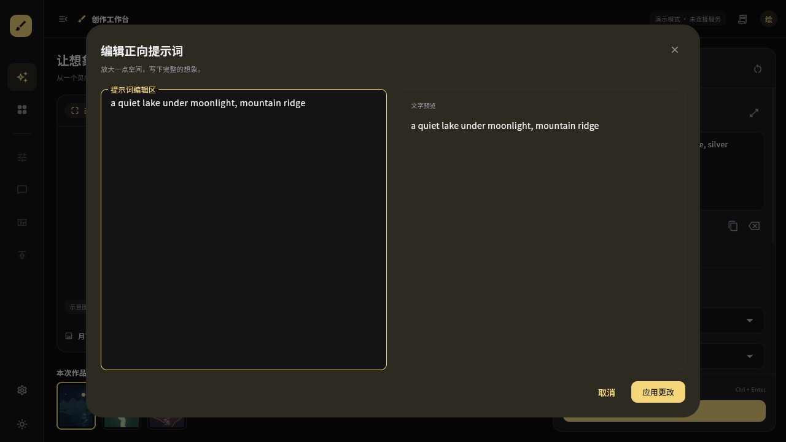

# 绘世 PC 三栏交互原型验收

日期：2026-10-11。范围：M1 的界面原型；M1 的数据库和平台探针仍未完成。

## 已交付

采用 Flutter Windows 独立桌面表现层，附同源 Flutter Web 预览，全部界面体验和截图在 Codex 内置浏览器进行。`lib/prototype` 明确隔离演示状态，后续接入业务时替换控制器，不把模拟逻辑当成生产渠道实现。

| 区域 | 当前可操作行为 |
| --- | --- |
| 左侧导航 | 200px 展开 / 72px 折叠；创作、图库、偏好；其余功能入口禁用并标注后续移植 |
| 中央工作区 | 三幅原创程序风景、缩放/重置、缩略图选择、收藏、图片详情、提示词或全部参数回填 |
| 右侧设置 | 正负提示词、展开编辑器、文字预览、取消/应用、复制/清空、追加标签、接入/模型选择、尺寸、步数、CFG、Seed |
| 角色交互 | 描述、保留内容的启停、5×5 定位；仅编辑交互，未进入生成请求 |
| 蒙版 | 连续笔画、画笔大小、撤销/重做；按作品 ID 隔离；没有擦除、导出或真实重绘接口 |
| 任务 | Ctrl+Enter / 生成按钮、三阶段模拟状态、取消；提交冻结基础输入，继续编辑不会改写已提交快照 |
| 图库 | 标题/提示词搜索、收藏筛选、详情及参数复用；当前会话内有效 |
| 主题 | 绘世近黑暖金 / 浅底蓝色；本地中文字体；减少动画选项 |

右侧滚动区与底部生成按钮分离。低于 1360px 默认折叠导航，低于 1060px 参数进入抽屉，低于 700px 导航也进入抽屉。狭窄/短窗口保留滚动入口，不隐藏主操作。

## 实际浏览器验证

基于本地 Release Web 构建，`http://127.0.0.1:5080/`，不接入任何外部生成服务。截图中提示词均为无隐私的自写风景描述。

- 1280×720：浅色布局、折叠导航、独立滚动与固定生成区；大提示词编辑器可见且可操作。
- 1440×900：深色完整三栏、图像预览、绘制蒙版、撤销后重做按钮可用、恢复笔画。
- 1920×1080：完整三栏，右侧参数可读；鼠标把步数从 28 调到 40，切换角色再返回仍为 40；还原参数回到 28。
- 提示词编辑器：键盘全选、删除、输入与实时文字预览、应用回主面板。取消不修改原草稿另有自动化用例。
- 模拟任务：阶段反馈、结果追加到当前作品；即时取消后数量保持 4，不追加伪结果。此前一次取消操作晚于约 3 秒的模拟完成，已据实际状态重新执行即时取消测试。
- 收藏和搜索：4 张作品收藏过滤为 1 张；输入“落日”只留下落日海岸。
- 角色定位：E5 点击后标签显示 E5；网格末行完整可达。
- 减少动画：选项启用后收展侧栏，输入草稿和作品保留。

已修正测试发现的侧栏底部 28px / 8px 水平溢出、主题按钮命中失败，以及 640×480 主导航抽屉底部 233px 溢出；也修正了角色网格用固定比例导致的末行裁切。

CUA 对 Flutter 已有文本调用 `fill` 会追加内容；浏览器验证改用键盘全选/删除/输入或产品清空按钮。没有把自动化适配行为误记为产品替换输入失败。

## 自动化与构建

- `flutter test --no-pub`：11 项通过（5 个状态用例、6 个布局交互用例）。覆盖提交快照与取消、参数回填、收藏、销毁，以及多尺寸布局、主题按钮命中、草稿保持、大编辑器、窄窗两侧抽屉。
- `dart analyze lib test`：无问题。
- 本次内置浏览器记录中没有 warn/error；源文件差异检查通过，上游 OFL 原文的一处尾随空格按原样保留。
- `flutter build web --release --no-web-resources-cdn --no-wasm-dry-run --no-pub`：通过。构建有 CupertinoIcons 字体查找提示；当前界面只使用 Material 图标，已实看所用图标正常。
- 本机 Flutter 分析服务器在中文项目路径报 JSON 解析错误，使用官方 Dart 分析器完成源码与测试检查，没有降低 lint 规则。
- Windows Release 构建通过，MSBuild 0 警告 / 0 错误；当前产物约 44 MB，包含完整字体与匹配原文哈希的 OFL 许可。仅验证编译和产物完整性，遵循全程内置浏览器要求，没有另外打开原生窗口验收。

### Windows 平台记录

原生可执行文件：`build/windows/x64/runner/Release/worldpainter_pc.exe`（须保留同目录 DLL 和 data）。SHA-256：`FA15FC0D8128219335CBF301ADCCA44C260711E646F989B6DF5423AE248B0FD3`。已从二进制 UTF-16 内容核对窗口标题包含“WorldPainter | 绘世”。这不是安装器，也未完成干净机器/系统缩放验证。

`scripts/build-windows.ps1` 为工作区建立临时 ASCII 目录映射，实际文件仍留在 PC端；结束时清理自身创建的映射和目录联接。没有修改 Flutter SDK。

保留并修复了三次环境问题：原中文路径 `app.dill` 被工具链乱码解析；直接映射盘符根目录时末尾反斜杠把 CMake 的 `FLUTTER_TARGET` 拼入 `PROJECT_DIR`；旧 Flutter assemble 缓存宣称已输出实际上缺失的 C++ wrapper。最终采用非盘符根的 ASCII 路径，并在 SDK 文件完整但项目 wrapper 缺失时归档旧生成缓存，让官方工具重新生成。失败缓存/日志保留在 `.tmp`。最终日志 `.tmp/windows-release-20261011-215110.log`。

## 截图证据

## 下一步与边界

本轮没有 SQLite、文件落盘、凭据保存、网络 Provider 或真实生成，刷新/关闭后草稿与图库不会保留。渠道和模型下拉只验证编辑流程；参考图、多角色正式数据、AI 助手、漫画、Pixiv、本地超分等仍是后续必移植项。`MOBILE_PARITY.md` 的业务完成状态不因原型按钮而变更。

下一步先用小型独立探针验证 SQLite 中文路径、事务、重开、schema 迁移、图片文件与索引部分失败恢复，再验证 Windows 凭据/文件和关键原生依赖。通过后才把原型状态替换为正式应用服务，并逐项导入手机端业务。

本轮 640×480 / DPR2 是 Widget 测试模拟，不等于 Windows 系统 200% 缩放人工验收。尚未测量原生启动、内存、帧时间、输入法候选窗、大图与大量图库压力；不宣称稳定 60 FPS 或全量移植完成。
