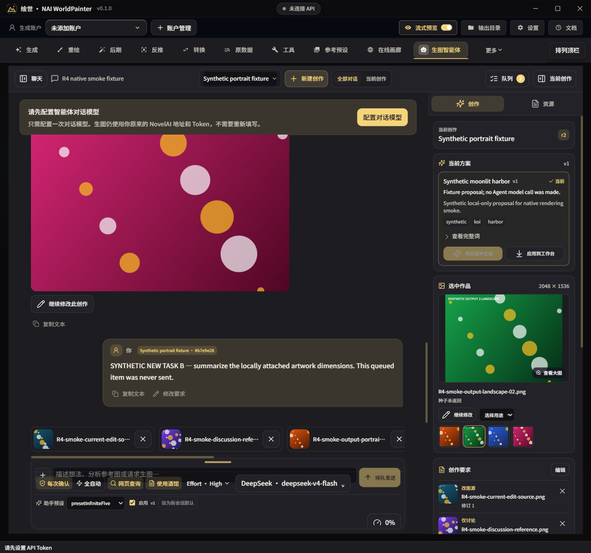
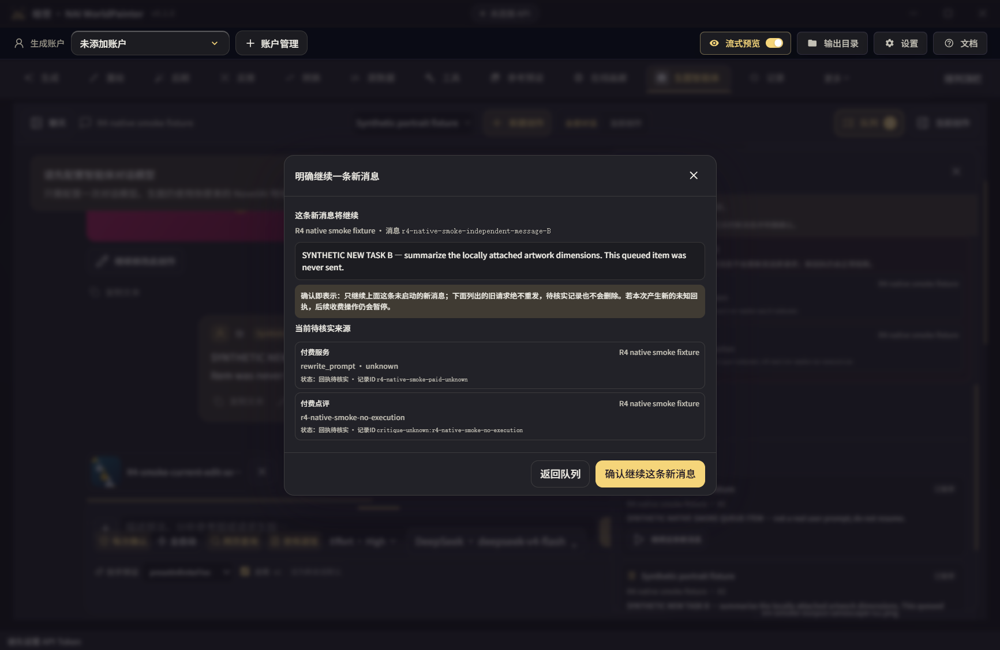

# R4 实施验证证据 · 2026-10-18

本目录记录 `feat/agent-r4-refactor` 的本地实施验证。旧设计原型与本次实际 Electron 产品运行分开保存；所有图片、消息、回执和 HTTP 供应商均为合成测试资料，未调用真实付费接口。

- [最终检查汇总](validation-summary.json)：4338 项测试，4336 通过、0 失败、2 跳过；类型检查、构建和 Windows x64 目录打包 exit 0。
- [完整 Vitest 报告](vitest-final.json)：480 个测试文件及逐项断言结果。
- [构建与打包 SHA-256 清单](build-manifest.json)：本轮修改源码、打包 EXE/ASAR、33 个关键文件与构建相同、Ajv 入包及 registry 内容比对。TypeScript 会重排导入 JSON 空白，故分别记录源合同和运行时文件 hash。
- [Electron SQLite 探针](electron-sqlite-probe.json)：Electron 42.11.0 / Node 24.19.0 / SQLite 3.53.3 的实际内建 SQLite 读写。
- [实际 preload/IPC](native-ipc-evidence.json)、[布局与重启](native-renderer-evidence.json)、[原生交互](native-ui-interactions.json)、[unknown 回执与新任务确认](native-unknown-gate-ui.json)、[重启后的主聊天](native-final-main.json)。原生收据内保留采集时 `.tmp` 绝对路径；对应最终截图副本在本目录 `screenshots/`。
- [打包 executable 冷启动](packaged-electron-smoke.json)：实际 `resources/app.asar` renderer、preload、独立 profile 中的 SQL 数据及 Agent UI；无自动队列启动或真实供应商请求。

## 代表截图

其他截图包括横图、竖图、800/1280/1920 视口、队列、输入快照、工作台差异预览和打包程序界面。队列确认框只打开而未点击收费确认；后端“只继续 B、保留 A”实际执行由 `r4-runtime-e2e.test.ts` 的 Pi + SQLite + fake provider 用例验证。

## 边界

本地服务故障注入、SDK HTTP 测试、SQLite 重开和隔离 Windows 程序运行分别证明对应层级，不等同真实收费服务或用户真实数据验收。没有穷举冻结 T01–T29/U01–U07 的所有组合；具体覆盖与缺口见 [验收记录](../../../AGENT_R4_ACCEPTANCE.md)。真实账号、供应商远端取消、多显示器/DPI、物理断电和可选外部 fixture 仍未验证。EXE 为完整 `win-unpacked` 目录的一部分，不能单独搬走运行。
